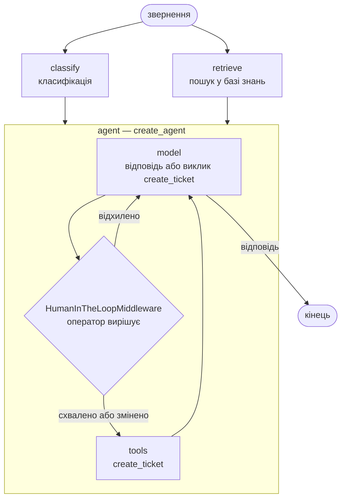
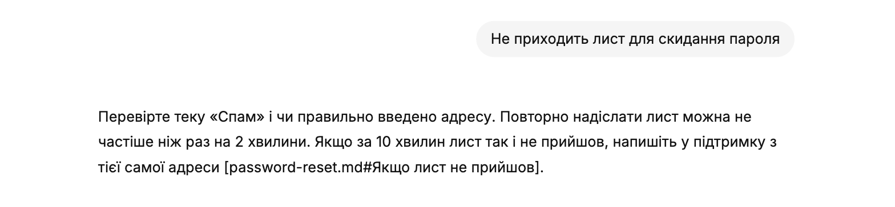
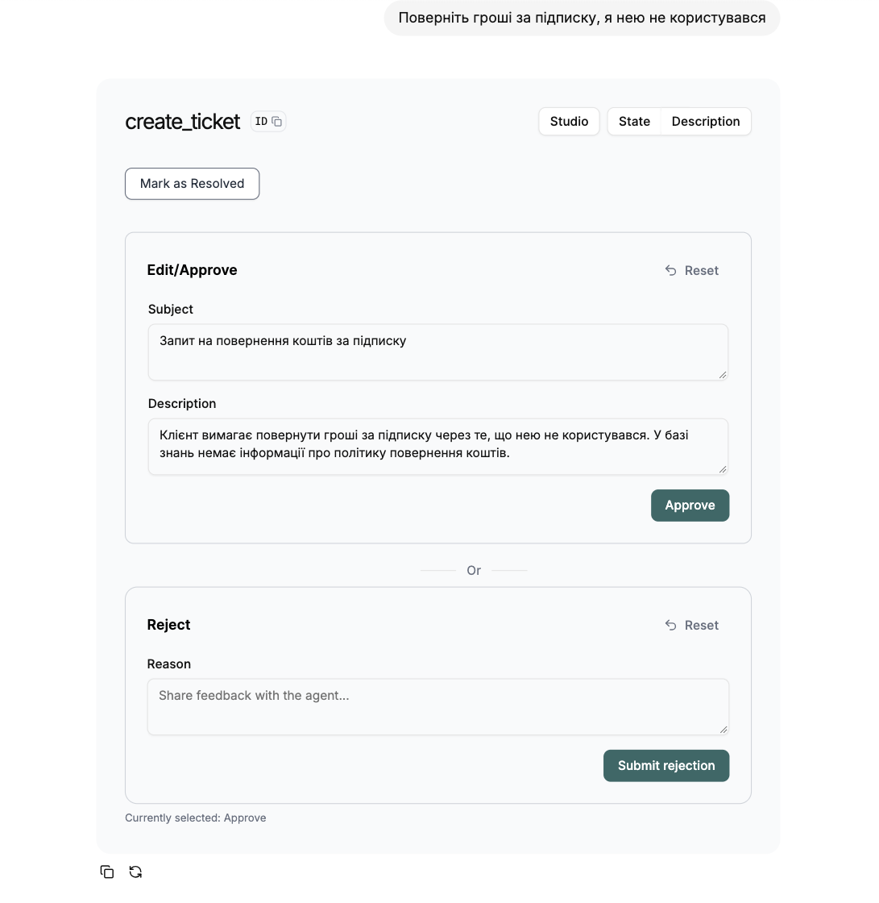
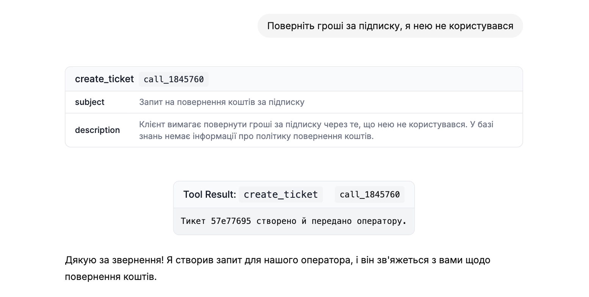

# Асистент технічної підтримки — навчальне демо

Демонстраційний приклад наскрізного кейсу міні-курсу «Впровадження систем генеративного штучного інтелекту». Асистент відповідає на звернення клієнтів умовного онлайн-сервісу бухгалтерського обліку для ФОП: шукає відповідь у базі знань, а коли її там немає, готує тикет оператору, який створюється лише після підтвердження людиною.

Код **навчально-ілюстративний**: він показує патерни, а не є готовим продуктом. Компанія, сервіс і статті бази знань вигадані.

## Що показує

- **Відповідь лише на основі бази знань, із джерелами.** Системні інструкції забороняють вигадувати; відповідь закінчується переліком використаних статей.
- **Пошук у базі знань (RAG).** Статті розбито на фрагменти за розділами і проіндексовано BM25. Так демо запускається з одним ключем, без окремого сервісу embeddings. Знайдені фрагменти потрапляють у системні інструкції моделі, а не в чат.
- **Класифікація звернення структурованим виходом.** Модель повертає валідований об'єкт (тема, терміновість, мова), а не текст, який треба розбирати.
- **Ескалація як інструмент із точкою контролю людиною.** Модель лише *пропонує* тикет викликом інструмента `create_ticket`. Штатний `HumanInTheLoopMiddleware` LangChain зупиняє граф до виконання інструмента й чекає рішення оператора: схвалити, змінити або відхилити.
- **Безпечний відкат.** Якщо модель недоступна, звернення не губиться: власний middleware перетворює збій на пропозицію тикета, і вона проходить ту саму перевірку людиною.
- **Стрімінг і облік токенів.** Відповідь з'являється по частинах; після неї показано витрачені токени, а за вказаних у конфігурації цінах — і вартість.

## Як влаштовано



Зовнішній граф LangGraph виконує класифікацію й пошук паралельно, а відповідає агент LangChain (`create_agent`). Поведінку агента задають три middleware: фрагменти бази знань у системних інструкціях (`dynamic_prompt`), відкат до людини при збої моделі і штатна перевірка людиною перед `create_ticket`. Результат класифікації не змінює маршруту: інструмент бере його зі стану графа й додає до тикета, щоб оператор одразу бачив тему й терміновість. Повну схему разом із вузлами агента друкує `uv run assistant --graph`.

| Файл | Що в ньому |
| --- | --- |
| `src/support_assistant/graph.py` | граф LangGraph і агент: стан, вузли, системні інструкції, інструмент `create_ticket`, middleware |
| `src/support_assistant/kb.py` | розбиття статей на фрагменти й пошук BM25 |
| `src/support_assistant/cli.py` | діалог у терміналі: стрімінг, підтвердження тикета, облік токенів |
| `src/support_assistant/server.py`, `langgraph.json` | точка входу для локального сервера LangGraph — для чату в браузері й LangGraph Studio |
| `src/support_assistant/config.py` | налаштування з `.env`, спільні для терміналу й сервера |
| `kb/` | сім статей бази знань |
| `tests/` | тести без мережі й ключа, на фейковій моделі |

## Запуск

Демо працює у двох інтерфейсах: у терміналі і в браузері як чат. Граф і база знань в обох однакові.

Потрібні Python 3.11 або новіший, менеджер пакетів [uv](https://docs.astral.sh/uv/) і ключ API.

1. Установіть uv за [інструкцією для вашої системи](https://docs.astral.sh/uv/getting-started/installation/). Якщо потрібної версії Python на комп'ютері немає, uv [завантажить її сам](https://docs.astral.sh/uv/guides/install-python/) під час першого запуску.
2. Отримайте ключ Gemini API в [Google AI Studio](https://aistudio.google.com/apikey) за [інструкцією Google](https://ai.google.dev/gemini-api/docs/api-key). Безкоштовного рівня досить для демо.
3. Скопіюйте `.env.example` у `.env` і впишіть ключ у `GOOGLE_API_KEY`.
4. Запустіть у терміналі:

```bash
uv run assistant "Як скинути пароль?"
uv run assistant              # діалог: кілька звернень поспіль
uv run assistant --graph      # граф у форматі Mermaid
```

Перший запуск сам установить залежності.

### Чат у браузері

[Agent Chat UI](https://github.com/langchain-ai/agent-chat-ui) — відкритий чат-інтерфейс LangChain для графів LangGraph. Він показує відповідь по частинах, виклик інструмента `create_ticket` і картку підтвердження, де оператор може схвалити тикет, відредагувати його перед створенням або відхилити. Ні акаунта, ні встановлення Node не потрібно: використовується розгорнута версія інтерфейсу, а граф виконується на вашому комп'ютері.

1. Запустіть локальний сервер (перший запуск доставить його пакети):

   ```bash
   uv run --group ui langgraph dev --no-browser
   ```

2. Відкрийте [agentchat.vercel.app](https://agentchat.vercel.app) і заповніть форму підключення:
   - **Deployment URL** — `http://localhost:2024`
   - **Assistant / Graph ID** — `assistant`
   - **LangSmith API Key** — залиште порожнім: для локального сервера він не потрібен.

   Форму можна пропустити: [це посилання](https://agentchat.vercel.app/?apiUrl=http://localhost:2024&assistantId=assistant) передає ті самі значення в адресі.

Сторінка з'єднується з сервером напряму з вашого браузера, тож звернення й відповіді проходять лише між браузером, вашим комп'ютером і постачальником моделі. Safari може блокувати з'єднання сайту з `localhost`; тоді скористайтеся Chrome або Firefox.

Відповідь із бази знань із посиланням на статтю:



Звернення, на яке в базі знань відповіді немає: асистент пропонує тикет, а граф чекає рішення оператора.



Після схвалення тикет створюється, і асистент повідомляє про це клієнта.



### LangGraph Studio

Якщо у вас є акаунт [LangSmith](https://smith.langchain.com), той самий сервер можна відкрити в [LangGraph Studio](https://docs.langchain.com/oss/python/langgraph/studio): він малює граф і підсвічує вузол, який зараз виконується, показує стан після кожного кроку й дає відповісти на `interrupt()`. Впишіть `LANGSMITH_API_KEY` у `.env` і запустіть сервер без `--no-browser`: Studio відкриється сам. Щоб запуски не потрапляли в LangSmith, додайте `LANGSMITH_TRACING=false`.

### Що спробувати

| Звернення | Що відбувається |
| --- | --- |
| «Не приходить лист для скидання пароля» | відповідь із бази знань і посилання на статтю |
| «Поверніть гроші за підписку, я нею не користувався» | у базі знань про повернення нічого немає, тож асистент пропонує тикет і чекає вашого рішення (`y` у терміналі, картка в чаті) |
| «Чи можу я перейти на третю групу єдиного податку?» | база знань прямо каже, що сервіс не консультує з оподаткування; подивіться, як модель це обробить |
| «Сайт не відкривається з самого ранку» | лексичний пошук не знаходить статтю про стан сервісу: у ній слово «сервіс», а не «сайт». Межа BM25, яку знімає семантичний пошук |

Створені тикети дописуються у `tickets.jsonl`.

## Квоти безкоштовного рівня і вибір моделі

Одне звернення витрачає 2–3 запити до моделі: класифікація, відповідь і, якщо створено тикет, ще одна відповідь клієнтові. Квоти безкоштовного рівня Gemini API рахуються на проєкт Google Cloud, а не на ключ, тож кожному, хто працює з демо, потрібен власний проєкт. Квоти скидаються опівночі за тихоокеанським часом; чинні значення для вашого проєкту — на [ai.dev/rate-limit](https://ai.dev/rate-limit). У жовтні 2026 р. вони були такими:

| Модель | Запитів на добу | Як поводиться в демо |
| --- | --- | --- |
| `gemini-3.5-flash-lite` (за замовчуванням) | 500, не більше 15 на хвилину | відповідає за секунди |
| `gemma-4-31b-it` | 14 000 | справляється з усіма кроками, але під навантаженням відповідає хвилинами, а частина запитів не завершується до тайм-ауту |
| `gemini-3.8-flash` | 20 | квоти вистачає на кілька звернень |

Якщо модель не відповідає за `MODEL_TIMEOUT` секунд (за замовчуванням 60) і після `MODEL_MAX_RETRIES` повторів (за замовчуванням 2), спрацьовує відкат до оператора, як при будь-якому іншому збої.

## Інший постачальник моделі

Модель задає один рядок у `.env` у форматі LangChain `<постачальник>:<ідентифікатор моделі>`. Для Anthropic або OpenAI спершу встановіть відповідний пакет:

```bash
uv sync --extra anthropic   # або --extra openai
```

і змініть `ASSISTANT_MODEL` та ключ за зразком у `.env.example`. Ідентифікатори моделей швидко змінюються, тож беріть їх з актуальної документації постачальника, а не з цього файлу.

## Тести

```bash
uv run pytest
```

Тести не звертаються до мережі: замість моделі — фейкова, що повертає заздалегідь задані відповіді.

## Чого тут немає

Демо покриває «щасливий шлях». Для реальної експлуатації потрібні щонайменше: семантичний пошук із переранжуванням і актуалізація бази знань; захист від prompt injection і фільтрація персональних даних; набір еталонних запитів і автоматичне оцінювання якості відповідей; журналювання, моніторинг і бюджет вартості; інтеграція зі справжньою тикет-системою.

## Що створює студент курсу

Демо показує, *до чого* веде курс, але не є розв'язком практичних робіт. На кожній практичній студент виконує крок того самого кейсу на власних вихідних даних і здає артефакт:

| Практична | Артефакт студента | У демо |
| --- | --- | --- |
| ПР1 | техніко-економічне обґрунтування: процес як є і як буде, межа «ШІ / алгоритм / людина», допустимий рівень помилки, відкат | немає |
| ПР2 | мінімальний асистент через API: системні інструкції під версіонуванням, структурований вихід | спрощено |
| ПР3 | пошук у базі знань: розбиття, індексація, джерела у відповіді | спрощено |
| ПР4 | інструмент «створити тикет» і ескалація до людини | спрощено |
| ПР5 | набір еталонних запитів, автоматичне оцінювання, порівняння з базовим рівнем | немає |
| ПР6 | захист від prompt injection і перевірка атаками, бюджет вартості й затримки | немає |

Курс завершується усним захистом власного проєкту.

## Дані й приватність

- **Не надсилайте асистенту реальних персональних даних** — РНОКПП, реквізитів рахунків, паролів, ключів КЕП. На безкоштовному рівні Gemini API Google використовує вміст запитів для покращення своїх продуктів.
- Ключ API зберігається лише в `.env`, який не потрапляє в git.
